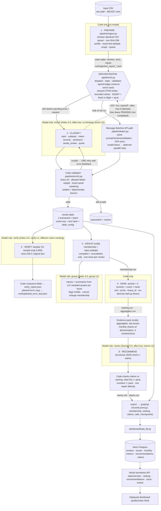

# Architecture

**Where code decides vs where a model judges.** Code: which texts are pending, batch boundaries, all counting, dedupe and cache reuse, validation of every returned field, retry/quarantine routing, spend and rate limits, membership, ranking arithmetic, evidence selection, and claim checking. Models: reading messy multilingual customer language (enrich), an independent second reading (verify), naming issues (group), and writing the argument (memo).

**Why each model call is needed.** Enrich: topic/intent/severity need language judgment across 40+ languages, slang, sarcasm — no keyword rule reaches acceptable agreement. Verify: an independent estimate of label error on a random sample. Group: human-readable issue names from bounded evidence (cosmetic; ranking never depends on it). Memo: synthesis of a business argument from aggregates — numbers are copied from the pack and checked by code.
